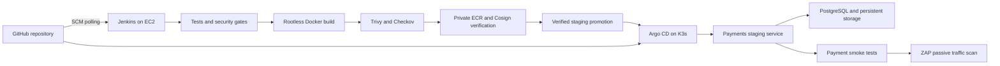
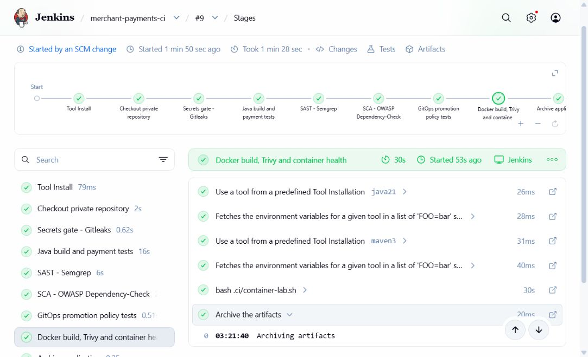
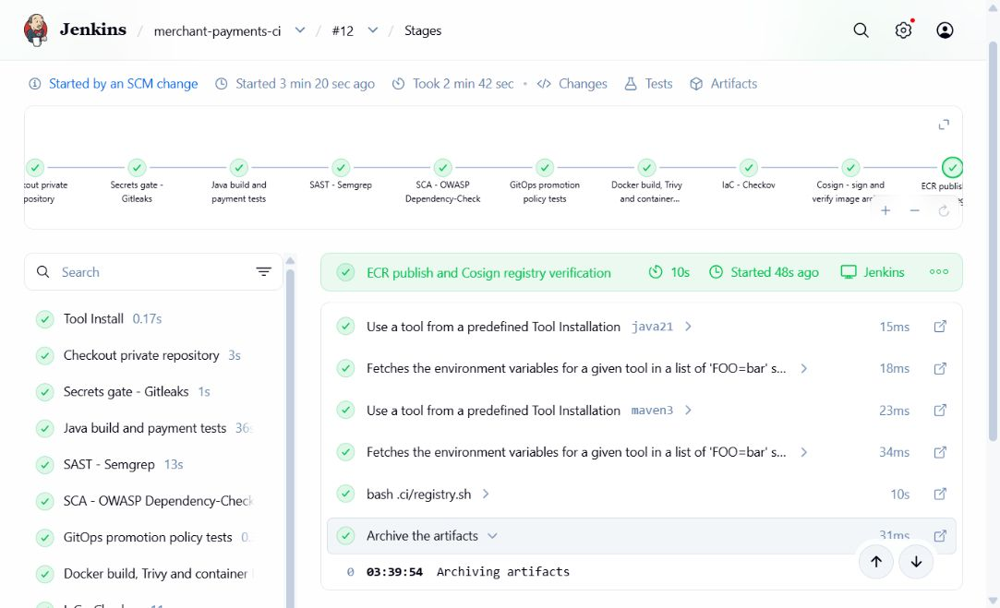
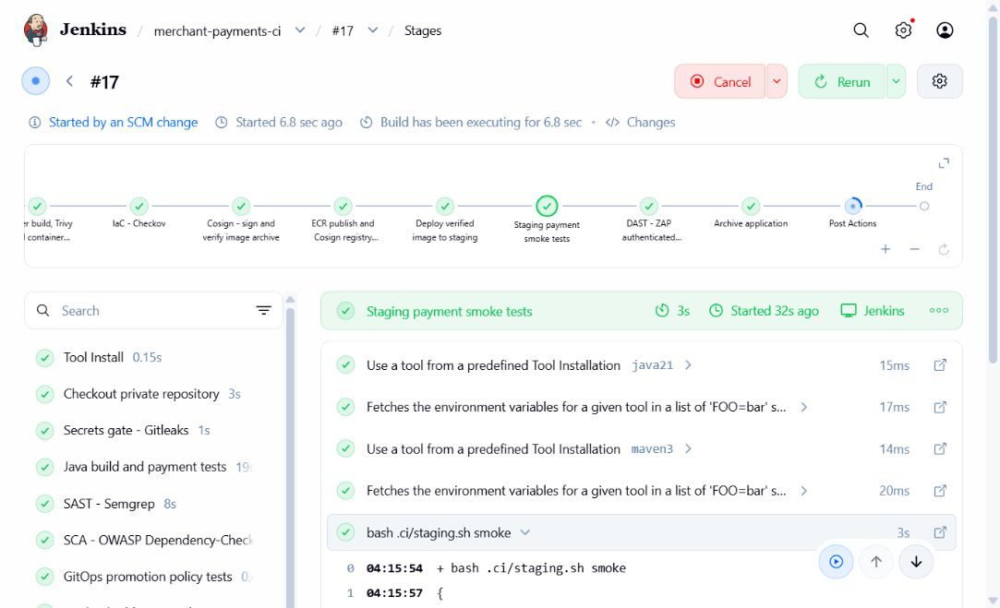
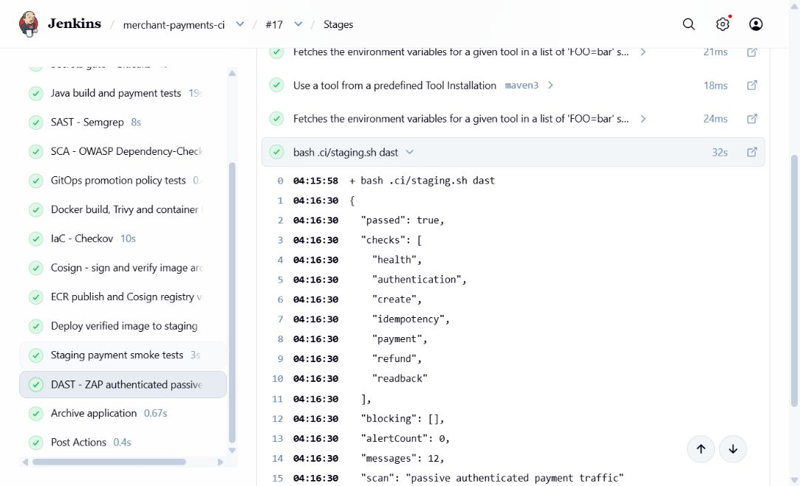

# Merchant Payments — AWS Jenkins DevSecOps Lab

A Spring Boot merchant-payments simulator delivered through a working security pipeline on AWS. It creates INR payment orders, handles idempotent retries, simulates payment outcomes and supports full refunds. **No real money, bank, card or UPI transactions are involved.**

This is the public portfolio edition of a private learning lab. It includes the application, pipeline, deployment templates and four implementation screenshots, with account-specific configuration removed and a fresh Git history. The original private repository remains connected to the lab. AWS account IDs are resolved from the authenticated instance role; the example staging values contain non-deployable placeholders.

**Verified milestone:** Jenkins build **#17 in the original private lab passed end to end on 28 October 2026 (IST)**: build/tests, security scans, image signing, staging deployment, payment smoke tests and passive ZAP DAST. The public edition's account-lookup and repository-parameter changes have local validation; they have not been redeployed to AWS. This records a completed lab run, not a guarantee that the EC2 instance is currently running.

[Implementation walkthrough and commands](docs/IMPLEMENTATION.md) · [Active pipeline](Jenkinsfile.ci) · [Application source](src/main/java/com/learning/payments)

## Architecture



Jenkins, rootless Docker, K3s, Argo CD and PostgreSQL share **one EC2 learning instance**. Access uses AWS Systems Manager tunnels; the security group has no inbound rules. ECR stores immutable image tags, and staging uses a verified image digest. PostgreSQL uses a PVC on the existing instance disk. This is a budget lab, not a highly available production architecture.

## What the pipeline does

| Step | Implementation / result |
|---|---|
| Checkout and secrets | Trusted main-branch checkout; Gitleaks rejects committed secrets |
| Build and tests | Java 21, Spring Boot 4.1.2, Maven; 19 application tests |
| SAST | Semgrep scans application Java code |
| SCA | OWASP Dependency-Check; blocks CVSS >= 7 findings and checks feed freshness |
| Promotion policy | 7 Python tests for immutable-image promotion rules |
| Container security | Rootless Docker; Trivy scans OS and Java dependencies, gates HIGH/CRITICAL, exports CycloneDX SBOM |
| IaC | Helm render/lint and Checkov; 92 checks each for staging/production chart renders in the verified run |
| Signing and publishing | Cosign signs the archive, then publishes and signs the ECR image digest; verifies source-commit annotation |
| Staging | Root-owned restricted helper verifies the registry signature and updates the Argo CD Application to the source commit and digest |
| Smoke tests | Health, authentication, create, idempotency, payment, refund and readback — all 7 passed |
| DAST | ZAP observes authenticated simulator traffic; 12 messages, zero alerts in build #17; medium/high alerts fail the gate |
| Evidence | Jenkins archives test results, security reports, SBOM, signing evidence and application JAR |

**Active definition:** `Jenkinsfile.ci`. The separate `Jenkinsfile` and older planning guides are earlier designs, not evidence of additional deployed features. ZAP still runs on every pipeline build; changing it to manual/release-only was discussed but has not been implemented. Archive signing remains enabled, but the large image tar is no longer retained as a Jenkins artifact.

## Four implementation screenshots

These show milestones as the pipeline grew; the build numbers are intentionally preserved.

### Container security — build #9



### ECR publishing and registry signatures — build #12



### Automated staging smoke tests — build #17

The smoke stage had passed when this screenshot was taken; the final build was still completing its post-actions.



### ZAP DAST results — build #17



## Run the application locally

Install JDK 21 and Maven 3. Set `PAYMENTS_API_KEY` to a securely generated random value of at least 32 characters in your local environment; never commit it.

```sh
mvn --batch-mode --no-transfer-progress clean verify
java -jar target/merchant-payments.jar
```

The local API listens on `http://127.0.0.1:8081`; `/actuator/health` reports health. Local storage uses H2, tests use an isolated in-memory database, and deployed staging uses PostgreSQL with Flyway migrations. The prepared Windows workspace also supports `scripts/dev.ps1 -Action Build` and `-Action Run` when its ignored `.tools` Maven installation is present.

| Endpoint | Purpose |
|---|---|
| `POST /api/payment-orders` | Create/replay an order; send `Idempotency-Key` |
| `GET /api/payment-orders/{id}` | Read an order |
| `POST /api/payment-orders/{id}/simulate` | Simulate `SUCCESS` or `FAILED` |
| `POST /api/payment-orders/{id}/refund` | Simulate a full refund |

API requests require `X-API-Key`. Example create body:

```json
{"merchantId":"demo-merchant","amountPaise":10000,"currency":"INR"}
```

Amounts use integer paise: 10000 paise = INR 100. Transactions, row locking and a database uniqueness constraint support valid state transitions and concurrent idempotent retries.

## Configure your own cloud lab

The public repository does not provision an AWS account or start cloud resources. The original lab used region `ap-southeast-2` and ECR repository `merchant-payments-lab`; adjust both the registry script and root-owned staging helper if using different settings. Provision the instance role, private ECR repository, Jenkins tools, Argo CD, runtime secrets, ECR pull-secret refresh and Cosign keys outside Git as described in the implementation walkthrough.

The registry script and staging helper resolve the AWS account through STS. The helper supplies `image.repository`, `image.digest` and `image.sourceCommit` to Argo CD after signature verification. Do not sync the placeholder staging image directly. Install the reviewed helper as a root-owned file; repository updates must not automatically replace that privileged copy. Configure Jenkins to build only your trusted main branch, with no untrusted pull-request builds on the privileged lab agent.

## Challenges we resolved

- **Vulnerable dependencies/base image:** upgraded dependencies and the container base/packages, then reran SCA, tests and Trivy rather than disabling the gates.
- **Memory pressure:** capped Java build/test/scanner heaps and added 1 GiB swap on the existing disk. Build #13 was interrupted during recovery; later builds passed.
- **Disk pressure:** ZAP's large image filled the small disk. Cleared reproducible caches and duplicate image-tar archives; retained the database and reports. Build #15 timed out while Kubernetes recovered.
- **Rollout connection timing:** the private port-forward still targeted the old pod during replacement. Added restart/readiness waiting before smoke tests after build #16 exposed the issue.
- **Empty scan risk:** require ZAP to capture at least seven messages and finish passive scanning before accepting its report.

## Scope and limits

This demonstrates a staging delivery workflow, not PCI-DSS certification or a production payment platform. It uses a shared demo API key, not per-merchant authorization. There is no real ledger, settlement, reconciliation or gateway integration.

Cosign uses a local encrypted signing key and explicit public-key verification; public transparency-log verification and cluster-wide admission enforcement are not configured. ZAP is passive, not a full active penetration test. Production deployment, canary releases and a full monitoring stack are deferred. Production chart checks do not mean a production environment exists.

The original lab was operated with a $5 credit target and a timed EC2 shutdown. This is not an enforced account-wide spending cap: EBS/ECR storage persists and can incur charges after EC2 stops. Localhost Jenkins/staging URLs work only while the instance and SSM tunnels are active. The public portfolio repository is source and documentation, not a hosted payment service.
