> Historical planning/verification document. For the implemented AWS staging lab and build #17 evidence, see [the current README](../README.md) and [implementation walkthrough](IMPLEMENTATION.md). Statements below may describe earlier milestones or deferred work.

# Jenkins CI and Argo CD deployment

Jenkins answers “did this code/image pass our checks?” Argo CD answers “does Kubernetes match the deployment configuration approved in Git?” Argo CD requires Kubernetes. It does not deploy a plain Docker container directly onto an EC2 host. EC2 can host Kubernetes worker nodes; EKS is one possible managed cluster choice.

## Flow

```mermaid
flowchart LR
  G[Application Git commit] --> J[Jenkins: Maven tests and GitOps policy tests]
  J --> S[Secret, infrastructure and packaged dependency/image checks]
  S --> D[Container smoke check]
  D --> E[ECR: publish tested image]
  E --> P[Review staging image-digest change in Git]
  P --> A[Argo CD staging auto-sync]
  A --> V[Verify rollout and payment API; capture evidence]
  V --> R[Review production promotion of the same digest]
  R --> M[Authorized manual production sync]
```



The repository contains a Helm chart, two environment values files, an Argo AppProject, and staging/production Applications. Staging auto-syncs and self-heals. Production has no automatic sync. These are configuration defaults, not already configured branch protection or RBAC.

## Required infrastructure before deployment

- A reviewed Git repository containing this project on protected `main`. Replace `REPLACE_ME` in the three `gitops/argocd/*.yaml` files with your repository URL. Give Argo read access using its credential configuration, not credentials embedded in URLs.
- A Kubernetes cluster with Argo CD installed. Apply `gitops/bootstrap/namespaces.yaml` separately using platform permissions; the AppProject cannot create cluster-scoped resources.
- PostgreSQL and separate staging/production databases/users. The app's Kubernetes profile explicitly requires the PostgreSQL driver and cannot use its local H2 fallback. PostgreSQL integration has not yet been exercised in this environment.
- An externally managed Secret in each namespace, named by that environment's `runtimeSecret`, containing `api-key`, `jdbc-url`, `username`, and `password`. The API key must be at least 32 random characters. Do not commit Secret values.
- Access for Kubernetes to pull the ECR image, through the appropriate node/runtime identity or configured image-pull Secret.

The chart starts Flyway on application startup, so its DB user needs migration permissions. Real environments should review migration privileges and compatibility separately. Readiness includes database availability; liveness does not depend on the database.

## CI prerequisites

Use a trusted Linux Jenkins worker labeled `build`, with Jenkins tool installations named `java21` and `maven3`. It also needs Docker Engine/CLI, Helm 3, Bash, curl, Python 3, OpenSSL, and AWS CLI v2 when publishing. The Docker daemon must be local to the worker for scanner bind mounts. This PC currently lacks Docker and no full Jenkins/container run is claimed.

Jenkins builds the JAR, runs Java and promotion-policy tests, validates Helm, scans secrets/configuration, builds one image, generates an SBOM, scans packaged OS/Java dependencies, and runs its health check. HIGH/CRITICAL image/configuration findings, any detected secret, or scanner errors fail their gates. There are no blanket vulnerability exclusions. A dedicated code SAST/SonarQube stage is not yet implemented.

Publishing defaults off. On a trusted `main` build, enable `PUBLISH_IMAGE` and supply your account ID, region, and existing immutable ECR repository. The worker uses its short-lived IAM role; keep that role limited to the required ECR operations. Run untrusted pull requests on separate workers without cloud roles. A Jenkinsfile branch condition alone is not a security boundary.

After passing gates, CI publishes and records `reports/release.json`, then prepares `reports/staging-promotion.patch`. It does not push Git, create a merge request, or call Argo's API. Review and apply the patch through your Git provider's protected merge process. Keep CI publishing permissions separate from production deployment permissions.

## Staging to production

The environment image begins with an intentionally non-deployable placeholder. The promotion script rejects placeholders and mutable tags.

```bash
# If preparing manually from a trusted successful CI artifact:
python3 scripts/gitops.py stage --release reports/release.json
git diff -- deploy/chart/environments/staging.json
```

Review, commit, and merge that change. After configuring the repo URL and runtime prerequisites:

```bash
python3 scripts/gitops.py validate --environment staging
kubectl apply -f gitops/argocd/project.yaml
kubectl apply -f gitops/argocd/staging.yaml
```

Wait for staging to become Synced and Healthy. In one terminal, forward its Service:

```bash
kubectl -n merchant-payments-staging port-forward svc/merchant-payments 18081:80
```

In another terminal, supply the staging `PAYMENTS_API_KEY` through your environment/secret workflow, then:

```bash
python3 scripts/verify_stage.py
python3 scripts/gitops.py promote --evidence reports/staging-evidence.json
git diff -- deploy/chart/environments/production.json
```

Verification checks the rollout, desired image digest/source commit, authentication, order creation, retry, simulated success, and refund. Promotion requires matching passing evidence and changes only production's image identity; it preserves production's replica count and Secret name. Evidence is a point-in-time local report, not a signed attestation. Review its CI provenance and freshness; access controls and protected reviews must prevent edited/forged evidence from authorizing a release.

Merge the reviewed production change, validate it, and create the production Application if needed:

```bash
python3 scripts/gitops.py validate --environment production
kubectl apply -f gitops/argocd/production.yaml
```

An authorized operator then syncs `merchant-payments-production` using Argo CD and verifies its health. Configure Argo RBAC to restrict production sync access. One shared lab cluster and one Git repo simplify learning. Separate deployment repositories/clusters/accounts are later isolation improvements; Argo recommends a separate configuration repository.

## Recovery

Revert the bad image/configuration commit in Git. Staging's automatic sync reconciles the reverted state; production requires an authorized sync. Do not depend on `kubectl rollout undo` while Argo self-heal still points to a bad Git revision. Argo automatic sync does not itself supply metrics-based canary analysis or automatic application rollback.

Reverting an image does not undo Flyway/database changes. Use backward-compatible migrations and verify recovery with the deployed schema. No recovery drill has been executed on a cluster yet.

Official references: [CI automation](https://argo-cd.readthedocs.io/en/stable/user-guide/ci_automation/), [automatic sync](https://argo-cd.readthedocs.io/en/stable/user-guide/auto_sync/), [Helm values](https://argo-cd.readthedocs.io/en/stable/user-guide/helm/).
